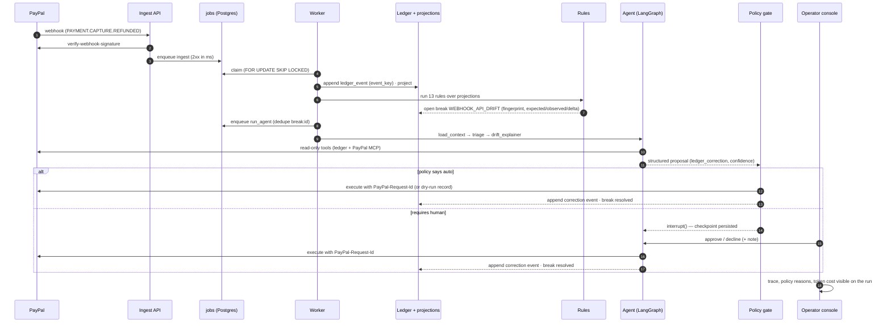

# Ledgerline — Architecture

Ledgerline is an autonomous revenue-operations agent for PayPal merchants. It
keeps an independent, event-sourced ledger of everything that happens on a
merchant's PayPal account, continuously reconciles that ledger against
PayPal's own APIs, and dispatches AI agents to resolve the breaks it finds —
drafting dispute evidence, recommending refunds, explaining drift — under a
policy engine that decides what runs autonomously and what waits for a human.

The thesis: AI should not be a chat box on top of payments. It should be a
worker inside a control loop that already has guardrails, idempotency and an
audit trail.


```
                 ┌──────────────────────────────────────────────────────────┐
                 │                         PayPal                           │
                 │  Orders v2 · Payments v2 · Payouts · Invoicing v2        │
                 │  Disputes v1 · Transaction Search · Webhooks             │
                 └───────┬───────────────────────────────▲──────────────────┘
          webhooks (push)│          polling (pull)       │ actions (refund,
                         │                               │ evidence, message)
                 ┌───────▼───────┐               ┌───────┴────────┐
                 │  Ingest API   │               │  PayPal client │
                 │ verify-sig →  │               │ OAuth cache,   │
                 │ enqueue       │               │ retries, rate  │
                 └───────┬───────┘               │ limits, idemp. │
                         │                       └───────▲────────┘
                 ┌───────▼────────────────────────────────┴────────┐
                 │                   Worker                        │
                 │  jobs (SKIP LOCKED) → normalise → append event  │
                 │  → project → reconcile → open breaks → dispatch │
                 └───────┬─────────────────────────────────────────┘
                         │
   ┌─────────────────────▼───────────────────────────────────────────────┐
   │                        Postgres (single source of truth)            │
   │  ledger_events (append-only)  ·  projections (orders, captures,     │
   │  refunds, payouts, disputes, invoices)  ·  breaks  ·  agent_runs    │
   │  approvals  ·  jobs  ·  langgraph checkpoints                        │
   └─────────────────────┬───────────────────────────────────────────────┘
                         │
                 ┌───────▼────────┐        ┌──────────────────────────┐
                 │  Agent runtime │◄──────►│ Policy engine (YAML)     │
                 │  LangGraph     │        │ auto-approve thresholds, │
                 │  triage →      │        │ escalation, blocklists   │
                 │  specialist →  │        └──────────────────────────┘
                 │  policy_gate → │
                 │  [interrupt] → │
                 │  execute       │
                 └───────┬────────┘
                         │
                 ┌───────▼────────┐
                 │  Dashboard     │  React + AG Grid: ledger explorer,
                 │  (FastAPI SPA) │  breaks queue, agent traces, approvals
                 └────────────────┘
```

## 0. Life of a break

What happens between a PayPal webhook and a resolved break, in the order the console shows it.
This is the path the demo follows.



## 1. Components

| Component | Tech | Responsibility |
|---|---|---|
| `backend/app/api` | FastAPI | HTTP surface: webhook receiver, read APIs for the dashboard, approval endpoints, health/metrics. Serves the built SPA in production. |
| `backend/app/ingest` | FastAPI + Postgres queue | Verifies webhook signatures with PayPal's `verify-webhook-signature`, stores the raw envelope, enqueues a job. Never does business logic inline — the request returns 2xx in milliseconds so PayPal does not retry. |
| `backend/app/worker` | Python process | Pulls jobs with `FOR UPDATE SKIP LOCKED`, runs the pipeline: normalise → append → project → reconcile → dispatch. Also runs the poller. |
| `backend/app/paypal` | httpx | Thin, typed client. OAuth token cache, exponential backoff on 429/5xx, `PayPal-Request-Id` idempotency on every mutating call, structured error mapping. |
| `backend/app/ledger` | SQLAlchemy | Append-only `ledger_events`, deterministic projections. |
| `backend/app/recon` | pure Python | Rule set over projections. Emits typed `Break`s with severity and evidence. |
| `backend/app/agents` | LangGraph | Triage → specialist graph with a Postgres checkpointer. Interrupts on any action the policy does not auto-approve. |
| `frontend` | React, Vite, AG Grid | Operator console. |

## 2. Data model

### 2.1 Ledger events (append-only)

```
ledger_events
  id              bigserial
  event_key       text  UNIQUE   -- idempotency: "<source>:<external_id>:<event_type>"
  source          text           -- webhook | poll | api | sim
  event_type      text           -- normalised, e.g. CAPTURE_COMPLETED
  resource_type   text           -- order | capture | refund | payout_item | dispute | invoice
  resource_id     text
  occurred_at     timestamptz    -- PayPal's time
  recorded_at     timestamptz    -- our time
  amount_minor    bigint         -- cents; never floats
  currency        char(3)
  payload         jsonb          -- raw PayPal resource
  correlation_id  text           -- order id where known; ties the chain together
```

Events are never updated or deleted. A re-delivered webhook or a poll that
returns a resource we already have hits the unique key and is a no-op.
Money is stored in minor units as integers; `app/domain/money.py` is the only
place that parses PayPal's string amounts.

### 2.2 Projections

Projections are rebuilt from events (`ledgerline rebuild`) and are the
tables the reconciler and dashboard read: `orders`, `captures`, `refunds`,
`payout_items`, `disputes`, `invoices`. Each carries `last_event_id` so a
rebuild is verifiable.

### 2.3 Breaks

```
breaks
  id, rule, severity (info|warn|critical), status (open|in_progress|resolved|dismissed)
  resource_type, resource_id, correlation_id
  expected jsonb, observed jsonb, delta_minor
  opened_at, resolved_at, resolution (jsonb: who/what/why)
  fingerprint text UNIQUE  -- rule + resource; a rule firing twice updates, not duplicates
```

### 2.4 Agent runs and approvals

`agent_runs` records every graph invocation: break id, thread id, model,
token usage, each tool call (name, args, result preview), the proposal and the
final outcome. `approvals` is the human-in-the-loop queue: proposal,
policy decision (`auto` / `requires_human` / `forbidden`), decided_by, decided_at.
Nothing mutates PayPal without a row here.

## 3. Ingestion

1. **Webhooks (push).** `POST /webhooks/paypal` reads the five PayPal
   headers, calls `/v1/notifications/verify-webhook-signature`, persists the
   envelope to `webhook_inbox` (status `received|verified|rejected`) and
   enqueues `process_webhook`. Rejected signatures are stored for forensics
   but never processed.
2. **Polling (pull).** Every N minutes the worker pages
   `/v1/reporting/transactions` and `/v1/customer/disputes`. This is the
   *second source of truth*: if a webhook was dropped, the poll catches the
   resource; if the webhook and the poll disagree, that is a break
   (`WEBHOOK_API_DRIFT`).
3. **Direct reads.** When a chain is incomplete (a capture with no order in
   the ledger) the worker fetches the parent via the API and appends it with
   `source=api`.

Normalisation maps PayPal's ~40 event names to ~14 ledger event types so the
reconciler is stable even when PayPal adds variants.

## 4. Reconciliation rules

Rules are pure functions `(projections) -> list[Break]`, registered in
`recon/rules.py`, each with a stable name, severity and a `fingerprint`.

| Rule | Fires when | Severity |
|---|---|---|
| `ORDER_AMOUNT_MISMATCH` | Σ captures ≠ order amount after order is COMPLETED | critical |
| `REFUND_EXCEEDS_CAPTURE` | Σ refunds > capture amount | critical |
| `DUPLICATE_CAPTURE` | Two completed captures for one order without a matching void | critical |
| `DUPLICATE_ORDER` | Same customer, same amount, two completed orders within 10 minutes (double-click checkout); fires on the later order until it is refunded | critical |
| `CAPTURE_WITHOUT_ORDER` | Capture referenced an order not in the ledger (after a fetch attempt) | warn |
| `WEBHOOK_API_DRIFT` | Status/amount from webhook disagrees with status/amount from API/poll for the same resource | critical |
| `STALE_AUTHORIZATION` | Authorisation older than the honour window with no capture/void | warn |
| `DISPUTE_RESPONSE_DUE` | Open dispute with `seller_response_due_date` inside the SLA window and no evidence submitted | critical |
| `DISPUTE_UNRECONCILED_HOLD` | Dispute hold amount not reflected in ledger balance | warn |
| `PAYOUT_ITEM_FAILED` | Payout item in `FAILED`/`BLOCKED`/`RETURNED` | warn |
| `PAYOUT_FEE_VARIANCE` | Fee on payout batch outside expected band | info |
| `INVOICE_PAID_NO_CAPTURE` | Invoice marked PAID with no corresponding capture event | warn |
| `SETTLEMENT_LAG` | Capture completed but no transaction in reporting after T hours | info |

Every break carries `expected`, `observed` and `delta_minor`, so the agent
and the operator see the same evidence.

## 5. Agent runtime

One LangGraph graph, checkpointed in Postgres so a run survives restarts and
can pause indefinitely for a human.

```
start ─► load_context ─► triage ─► specialist ─► policy_gate ─┬─ auto ──────────► execute ─► close
                                   (dispute_defender │           ├─ requires_human ► wait_for_human [interrupt] ─► execute / close
                                    refund_advisor   │           └─ forbidden ────► close
                                    drift_explainer) ┘
```

* **load_context** — loads the break and its fingerprint into graph state.
  The specialist node is what gathers the event chain and live PayPal state, via tools.
* **triage** — classifies the break, decides which specialist runs, and
  states what evidence is missing. Output is structured (pydantic), not prose.
* **specialist** — one node whose prompt is chosen by triage; the three
  specialists are:
* **dispute_defender** — assembles an evidence packet: order details,
  capture, shipment tracking (via PayPal tracking tool when present),
  customer communication, policy text. Drafts a response in PayPal's
  expected format and proposes `provide_evidence`.
* **refund_advisor** — computes the entitled amount from the ledger (never
  from the LLM), proposes full/partial refund or decline with rationale.
* **drift_explainer** — for `WEBHOOK_API_DRIFT` / `ORDER_AMOUNT_MISMATCH`,
  determines which side is wrong, proposes a ledger correction event or an
  escalation.
* **policy_gate** — deterministic. Reads `policy.yaml`; e.g. refunds ≤ $25
  on orders < 30 days old auto-execute, anything touching a dispute requires
  a human, blocklisted customers always escalate.
* **execute** — the only node that mutates PayPal. Each approval carries an
  idempotency key (hash of run, break and action) sent as `PayPal-Request-Id`,
  and an executed approval is never executed again, so retries cannot double-refund.

Tools exposed to the LLM are a curated subset of PayPal's agent toolkit
(read-heavy: get order, get dispute, list transactions, get tracking) plus
Ledgerline's own ledger tools. Mutating PayPal tools are **not** given to the
LLM; the graph calls them itself after the policy gate.

The LLM is swappable via `LLM_MODEL` (LangChain `init_chat_model`). Default
is Anthropic Claude; any provider with tool calling works.

## 6. Policy engine

`policy.yaml` is versioned with the code and loaded at start. Every policy
decision is written to the approval row with the policy version, so an
auditor can replay why something ran unattended.

```yaml
version: 1
auto_approve:
  refund:
    max_amount_minor: 2500          # <= $25.00
    max_order_age_days: 30
    not_if: [dispute_open_on_order, prior_refund_on_capture, payer_blocklisted]
  ledger_correction:
    allowed_rules: [SETTLEMENT_LAG]
  no_action:
    allowed_rules: [PAYOUT_FEE_VARIANCE, INVOICE_PAID_NO_CAPTURE]
never_auto: [provide_evidence, accept_claim, void_authorization, escalate]
payer_blocklist: []
max_refund_minor: 100000            # hard ceiling even for humans
min_confidence_for_auto: 0.8        # below this nothing runs unattended
```

The gate is plain Python over this file (ADR 0006). Its output is `auto`, `requires_human` or
`forbidden` (above `max_refund_minor`, or a non-positive amount) plus the reasons, and both are
stored on the approval row.

## 7. Reliability properties

* **Idempotent everywhere.** Ledger by `event_key`, breaks by
  `fingerprint`, PayPal mutations by `PayPal-Request-Id`, jobs by
  `(kind, dedupe_key)`.
* **Exactly-once effects, at-least-once delivery.** Webhooks are acked
  before processing; the queue retries with backoff; the unique keys make
  retries harmless.
* **Rebuildable.** `ledgerline rebuild` drops projections and replays
  events. Breaks are recomputed from projections, so a rule change
  re-evaluates history.
* **Observable.** Structured JSON logs with `request_id`/`job_id`,
  `/metrics` (Prometheus text), `/healthz` that checks DB and PayPal auth.
* **Safe by default.** `PAYPAL_ENV=sandbox` is enforced unless
  `ALLOW_LIVE=true`; without it the app refuses to start in live, and the PayPal client
  refuses every mutating call.

## 8. Simulator and fixture replay

`ledgerline sim seed` creates realistic sandbox activity using the Orders
API with a card `payment_source` (no browser redirect needed), captures,
partial refunds, a payout batch and invoices. `ledgerline sim inject`
corrupts the ledger deliberately (e.g. records a refund that PayPal never
saw) so reconciliation has something to find.

`ledgerline sim replay` (the bundled fixture, or a `.jsonl` path) replays recorded PayPal payloads through
the same pipeline, so the full demo works with no network and judges can
reproduce it in under five minutes.

## 9. Deployment

One Docker image (multi-stage: Node builds the console, a slim Python image with Node serves
the API and runs the worker — Node is there because the agent runs PayPal's MCP server as a
subprocess). `render.yaml` is a Render Blueprint that declares three resources from it:

| Resource | Role | Notes |
|---|---|---|
| `ledgerline` (web) | FastAPI + built SPA | `/healthz` health check; `alembic upgrade head` as pre-deploy; `OPERATOR_TOKEN` generated by Render |
| `ledgerline-worker` | `ledgerline worker` | drains jobs, runs agents, polls PayPal every `POLL_INTERVAL_SECONDS`; seeds the fixture once into an empty ledger when `DEMO_SEED_ON_START=true` |
| `ledgerline-db` | managed Postgres 16 | ledger, projections, breaks, runs, approvals, jobs, LangGraph checkpoints |

Secrets (`PAYPAL_*`, `LLM_API_KEY`) are `sync: false` — set in the dashboard, never in the file.
Push to `main` deploys both services; Blueprint changes sync with an approval step.

Live instance: https://ledgerline-wcpx.onrender.com (fixture-seeded, PayPal executor in dry-run).
Operations: [`RUNBOOK.md`](RUNBOOK.md). Local: `docker compose up` or the five-minute path in the README.

## 10. What we deliberately did not build

* No live-mode support in the demo build. The hackathon is sandbox-only and
  the risk of an agent moving real money is the point of the policy gate.
* No LLM-authored amounts. Every number the agent proposes is computed from
  the ledger and shown as evidence.
* No chat UI. Operators see breaks, proposals and traces, not a prompt box.

## 11. Production hardening — what changes beyond the demo

Honest list of the gap between this build and a merchant running it on live money, in the
order we would close it. None of these change the architecture; they add around it.

| Area | Today | Production |
|---|---|---|
| Identity | shared `OPERATOR_TOKEN` | SSO (OIDC) in front of the console; viewer / operator / admin roles; `approved_by` on every approval row |
| Tenancy | one merchant per deployment | `merchant_id` on every table and in every fingerprint; per-merchant PayPal credentials and policy version |
| Secrets | platform env vars | a secrets manager with rotation; PayPal credentials scoped per merchant |
| Policy | `policy.yaml` in the image | versioned policy rows written from a console editor; the gate records the row id |
| Agent throughput | one worker, serial runs | N workers on the same `SKIP LOCKED` queue, or agent runs fanned out as Render Workflow tasks |
| Live mode | gated off (`ALLOW_LIVE`) | enabled per merchant after a dry-run period in which every would-be action is reviewed |
| PII | stored as received from PayPal | retention window per merchant; purge-and-replay via the event log |
| Observability | structured logs, `/metrics`, `/healthz` | SLOs: webhook-to-break latency, run duration, approval age; alerts on `webhooks_rejected`, parked jobs, escalation rate |
| Evidence | notes and typed evidence items | file attachments on `provide-evidence` (PayPal supports multipart); tracker lookup via the Add Tracking API |
| Sources | PayPal only | Braintree and Venmo events through the same ledger/rules; same breaks, more inputs |

Security controls and their residual risks are in [`THREAT_MODEL.md`](THREAT_MODEL.md);
the decisions behind the design are in [`adr/`](adr/README.md).
